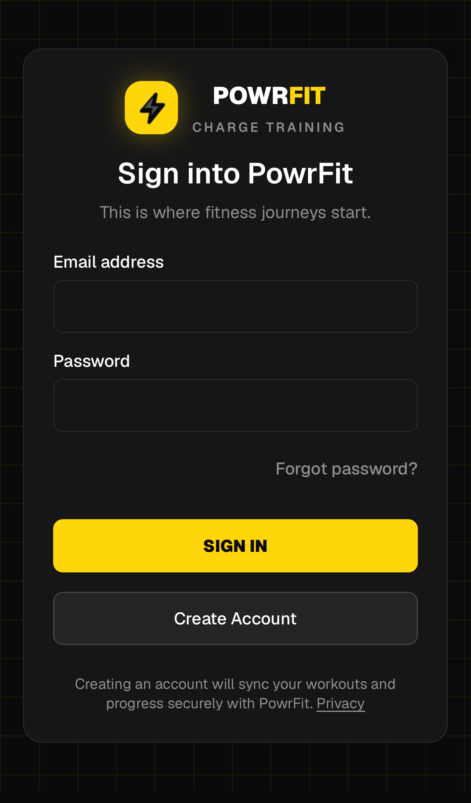

# PowrFit

A mobile-first workout tracker that runs in the browser and installs on your phone like a native app.

**Try it:** https://powrfit-andylafleur.netlify.app



## What it does

- **Log workouts fast:** an exercise picker, sets and reps, a "last time" line for each exercise, a rest timer and personal-record badges
- **Routines:** push, pull and leg-day presets, your own routines, and "Save as routine" from any workout
- **Progress:** charts, history, editable past workouts and lifetime stats, in kg or lb
- **Works offline:** workouts are saved on the device first and sync to the cloud when you're back online, with an honest sync status
- **Gyms near you:** nearby gyms from OpenStreetMap, plus price reports from the community
- **Suggested videos:** technique videos picked from what you've been training

## Install on your phone

- **iPhone:** open the link in Safari, tap **Share**, then **Add to Home Screen**
- **Android:** open the link in Chrome and tap **Install app**

## Stack

- **Next.js 16** (App Router), React 19, TypeScript, Tailwind CSS
- **PWA:** web app manifest plus a hand-written service worker with an offline fallback
- **Firebase:** Auth and Firestore with an offline-persistent cache; security rules are covered by emulator tests
- **Netlify:** hosting, plus a `/api/gyms` route handler that queries OpenStreetMap's Overpass API and is cached at the CDN
- **Testing:** Vitest unit tests, Firestore rules tests and Playwright end-to-end tests (`npm run verify`)

## Run it locally

```bash
cd web
npm install
cp .env.example .env.local   # add your Firebase web config
npm run dev
```

To run without a real Firebase project, use the emulators instead. See [web/docs/local-testing.md](web/docs/local-testing.md).

## Repo layout

- `web/`: the PowrFit web app (this is what's deployed)
- The Expo / React Native files at the repo root are the retired first version and are not deployed
